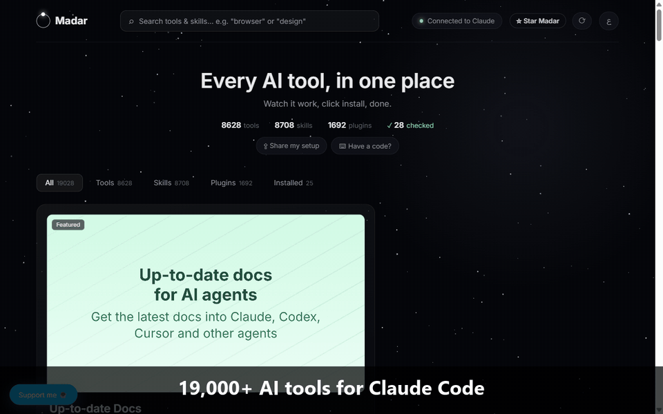

<div dir="rtl">

# مدار · Madar 🌌

[English](README.md) · **العربية**



**متجر واحد لكل أدوات الذكاء الاصطناعي ومهاراته داخل Claude Code.** تتصفح المتجر وتشوف كل أداة وهي تشتغل، تضغط **تثبيت**، وClaude يثبّتها لك ويقول لك وين وصل خطوة بخطوة.

> مدار لـ **Claude Code**: تبويب Code في تطبيق Claude لسطح المكتب، أو Claude Code في الطرفية.

## التثبيت

انسخ رابط هذا المستودع وقل لـ Claude:

> ثبّت لي هذا: github.com/iizhq55/madar

وClaude يكمل الباقي.

### إلى Claude: كيف تثبّت مدار

شغّل هذين الأمرين:

```bash
claude plugin marketplace add iizhq55/madar
claude plugin install madar@madar --scope user
```

للتجربة من نسخة محلية، استخدم مسار المجلد بدل `iizhq55/madar`:

```bash
claude plugin marketplace add C:/path/to/madar
```

بعدها قل للمستخدم: "تم ✅. اكتب `/reload-plugins` أو افتح محادثة جديدة، وبعدها قل لي: افتح المتجر."

## زر التثبيت المباشر (اختياري)

عشان توصل ضغطة "تثبيت" لـ Claude على طول، شغّل Claude Code من الطرفية بهذا الأمر:

```bash
claude --dangerously-load-development-channels plugin:madar@madar
```

هذا مطلوب مؤقتاً لين تعتمد Anthropic ميزة القنوات (Channels).

بدون هذا الأمر، Claude يراقب صفحة المتجر وتوصله ضغطاتك على طول (يشتغل في تطبيق سطح المكتب). وإذا ما قدر، الزر ينسخ لك سطر مثل `مدار: ثبّت playwright`، تلصقه في المحادثة، وClaude يكمل.

## ادعم مدار ❤

إذا عجبك مدار، تقدر تدعمه بأي مبلغ: **[ko-fi.com/iizhq55](https://ko-fi.com/iizhq55)**. وفيه زر «❤ ادعم مدار» داخل المتجر نفسه.

## الأمان

- **الفحص:** المتجر يعرض كل شي، واللي يعدّي الفحص عليه علامة **✓ مفحوصة**. الفحص يشمل: هل الأداة شغالة، ومحدثة، وما فيها كود خبيث، ولها رخصة، ومصدرها موثوق. وقبل تثبيت أي أداة ما انفحصت، Claude يسألك أول.
- **الوصفات:** Claude ينفذ بس الأوامر المبنية من "وصفة" منظمة وثابتة في الكتالوج، وما ينفذ أي نص جاي من الصفحة.
- **النسخة:** يتثبت نفس الإصدار اللي انفحص بالضبط.
- **الحماية المحلية:** الصفحة تشتغل على جهازك بس، على العنوان `127.0.0.1`، ومحمية برمز سري لكل جلسة.


</div>
