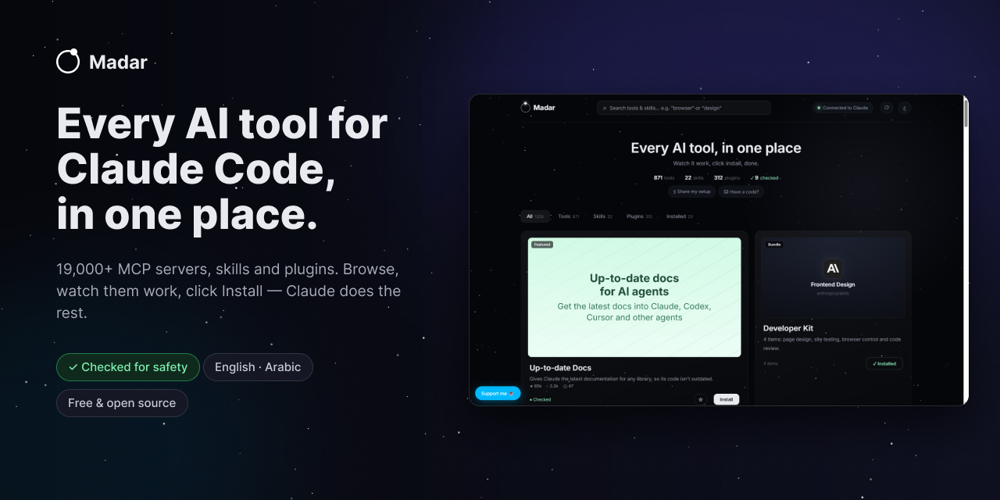
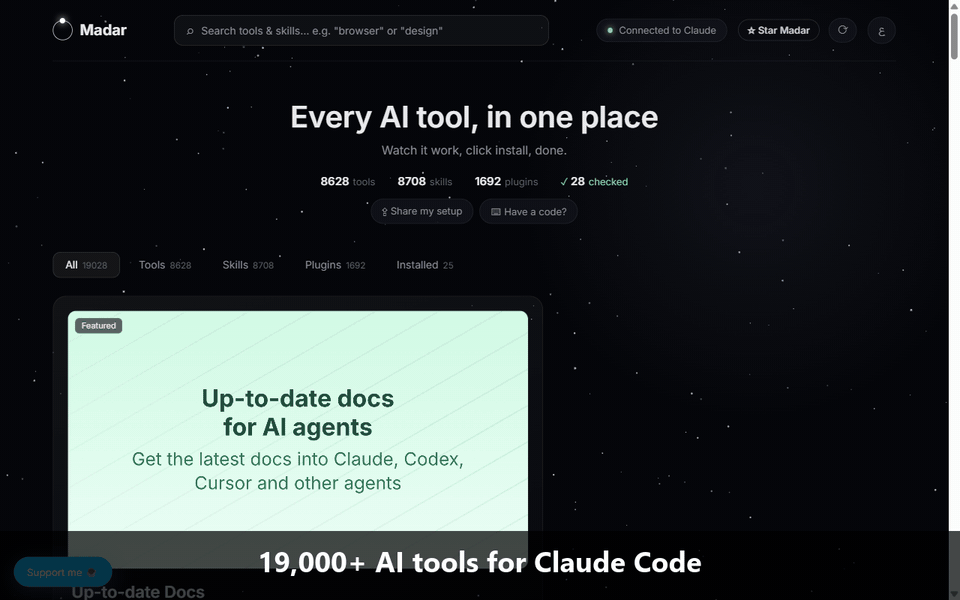
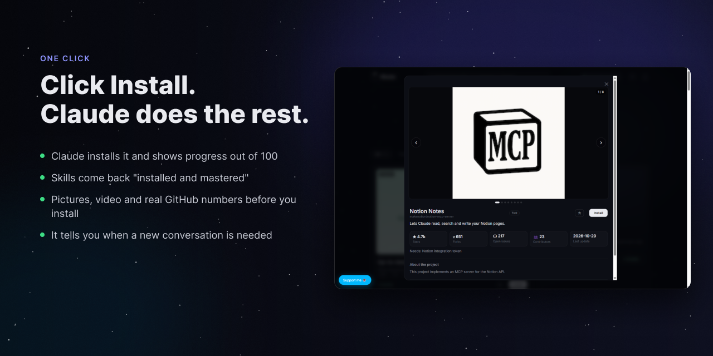
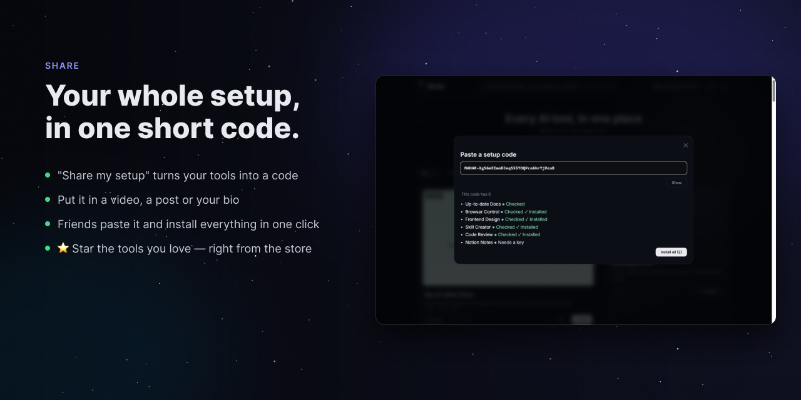
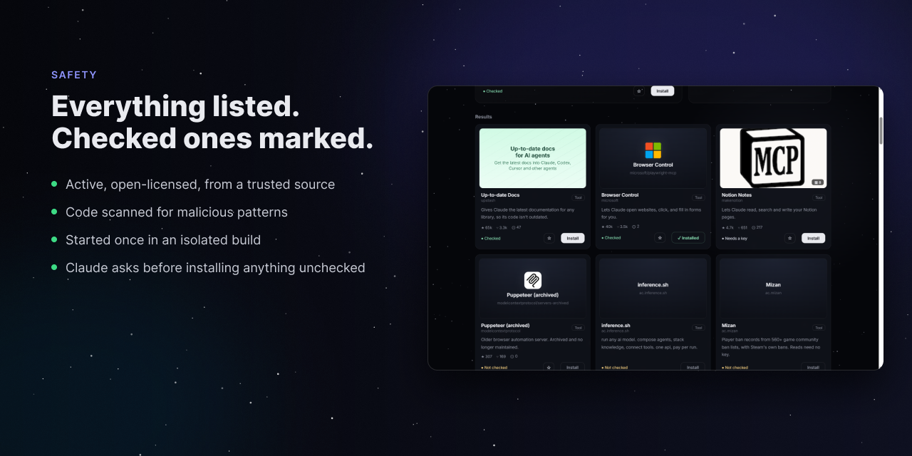

<div align="center">



# Madar

**One store for every AI tool, skill and plugin for Claude Code.**
Browse 19,000+ MCP servers, skills and plugins, see each one in action, click **Install** — Claude installs it for you.

[](https://github.com/iizhq55/madar/stargazers)
[](https://github.com/iizhq55/madar/releases)
[](https://iizhq55.github.io/madar/catalog.json)
[](https://claude.com/claude-code)
[](LICENSE)

**English** · [العربية](README.ar.md)



[](https://ko-fi.com/O2I32AVDW0)

</div>

---

## Why Madar?

Finding good AI tools today means digging through GitHub, reading READMEs, copying commands into a terminal and hoping they work.

Madar turns that into a store:

- **Everything in one place.** 19,000+ tools: MCP servers from the official MCP registry, plugins from 130+ Claude Code marketplaces, and skills from 130+ GitHub repos. New ones are found automatically every hour.
- **See it before you install it.** Each tool shows its own pictures and video, what it does, and real GitHub numbers: stars, forks, open issues, contributors and last update.
- **One click, no terminal.** Press **Install** and Claude does the rest, showing progress out of 100. Skills come back *installed and mastered*.
- **Checked for safety.** Tools that pass every check carry a **✓ Checked** mark. Claude asks before installing anything unchecked.
- **Made for everyone.** English by default, Arabic with one tap. Claude replies in the page's language.

## A quick look







## Install

You need **[Claude Code](https://claude.com/claude-code)**: the Code tab of the Claude desktop app, or Claude Code in a terminal. You also need **Node.js 22+** and **Git**.

**The easy way:** give Claude this repository and say:

> Install Madar for me: https://github.com/iizhq55/madar

**By hand:**

```bash
claude plugin marketplace add iizhq55/madar
claude plugin install madar@madar --scope user
```

Then type `/reload-plugins` (or open a new conversation) and say **"open the store"**.

## Using Madar

| You want to… | Do this |
|---|---|
| Open the store | Say *"open the store"* |
| Install something | Press **Install** on it |
| Remove something Madar installed | Open the **Installed** tab and press **Remove** |
| Star a tool on GitHub | Press **☆** next to Install (uses your GitHub sign-in) |
| Share your setup | **Share my setup** gives you a code; friends paste it in **Have a code?** |
| Update Madar | Press **⟳** (Check for updates) at the top of the store |
| Switch language | Press the language button at the top right |

## 🤖 For Claude

If a user gives you this repository, they want Madar installed in Claude Code. Do this:

1. **Check the basics.** Run `node --version`. Madar needs Node.js 22 or newer.
   - If Node is missing or too old, say so in one sentence.
   - Offer to install Node LTS (`winget install OpenJS.NodeJS.LTS` on Windows, `brew install node` on macOS, the distro's package on Linux), and run it only after the user says yes.
2. **Install the plugin:**
   ```bash
   claude plugin marketplace add iizhq55/madar
   claude plugin install madar@madar --scope user
   ```
3. **Tell the user:** "Done ✅ Type `/reload-plugins` (or open a new conversation), then say: open the store."
4. **After that, the bundled `madar` skill takes over.** It explains how to:
   - open the store page (`madar_open_store`) and watch for Install clicks;
   - install, remove and star items, and update Madar itself;
   - share setups.

   Follow that skill.

Rules:
- Only run commands that the Madar tools return.
- Never bypass permission prompts.
- Ask before installing anything that isn't checked.
- Reply in the user's language.

## Safety

- **What "Checked" means.** A tool is marked checked only when all five checks pass:
  - it is actively maintained;
  - it has an open license;
  - it comes from a trusted source;
  - a code scan finds no malicious patterns;
  - it actually starts.
- **The code that gets checked is the code that gets installed.** npm packages are read from the published package, and plugins from the exact commit their marketplace pins.
- **Tools are tried in isolation.** Third-party servers run only in a separate GitHub Actions job with no secrets. That job cannot change what gets published.
- **Pinned recipes.** Claude only runs commands built from structured, validated recipes, pinned to the checked version. Nothing on the page can make Claude run arbitrary text.
- **Local and private.** The store page runs on `127.0.0.1` with a per-session token. Madar has no servers of its own and collects nothing.

## Support Madar ❤

If Madar saves you time, you can support it on Ko-fi. There's also a **Support me** button inside the store.

[](https://ko-fi.com/O2I32AVDW0)

## Development

```bash
npm install
npm test        # unit tests
npm run dev     # preview the store page against the seed catalog
```

**How it fits together:**

| Part | Where |
|---|---|
| Store page | `plugin/ui/` |
| MCP server | `plugin/src/`, bundled to `plugin/dist/server.mjs` |
| Skill that drives Claude | `plugin/skills/madar/SKILL.md` |
| Hourly catalog build | `.github/workflows/catalog.yml` + `scripts/build-catalog.ts` |

**Testing a local checkout:** run `claude plugin marketplace add C:/path/to/madar`, which reads the plugin straight from the folder. After changing server code, the running Madar server keeps the old code until it restarts: reconnect it from `/mcp` or start a new session.

## License

[MIT](LICENSE)
